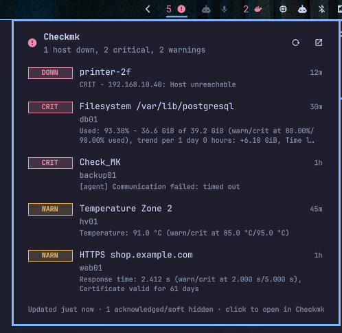

# OmarMK

An [Omarchy](https://omarchy.org) bar widget that keeps an eye on a
[Checkmk](https://checkmk.com) monitoring site and tells you when something
needs attention.

- **Bar icon**: a heartbeat when everything is OK. When something is wrong it
  shows a count of problems with a warning or critical icon, and turns your
  theme's urgent colour when anything is CRIT or DOWN.
- **Popup**: every host that is down and every service that is WARN, CRIT or
  UNKNOWN, worst first, with the check output and how long it has been that
  way. Click a row to open it in the Checkmk web UI.
- **Notifications**: a desktop notification when a host or service newly
  enters a problem state or gets worse (WARN → CRIT). The first check after
  login sends one summary instead of a pile of popups.
- **Ask the AI agent**: hand one problem, or all of them, to Omarchy's default
  coding agent (`omarchy agent`) in a terminal, with the check output and
  instructions to find the root cause and ask before changing anything.



## Install

```bash
omarchy plugin add https://github.com/Comm4nd0/omarmk
omarchy plugin enable io.github.comm4nd0.omarmk
```

The widget lands in the right section of the bar. Move it with
`omarchy bar move io.github.comm4nd0.omarmk --section <left|center|right>`.

## Set up

OmarMK talks to the Checkmk REST API (Checkmk 2.2 or newer) as an
**automation user**. Give it its own read-only user rather than reusing an
admin one.

### 1. Create a read-only automation user in Checkmk

In the Checkmk web UI: **Setup → Users → Add user**

- Username: `omarmk`
- Authentication: **Automation secret for machine accounts**. Generate a
  secret and copy it.
- Roles: **Guest user** only (read-only: it can see everything and change
  nothing)
- Contact groups: whichever groups you want to watch. Users only see hosts
  and services in their contact groups unless the role can see everything,
  which Guest can.

Save, then **Activate on selected sites**.

### 2. Store the secret

```bash
mkdir -p ~/.config/omarmk
install -m 600 /dev/null ~/.config/omarmk/secret
$EDITOR ~/.config/omarmk/secret     # paste the secret, save
```

The secret lives only in this file. It is never written to `shell.json`,
never put on a command line, and never loaded into the shell's QML scene:
the bundled `bin/omarmk-fetch` reads it and hands it to `curl` on stdin.

### 3. Point the widget at your site

The site URL is everything before `/check_mk/` in your browser, for example
`http://checkmk.lan/mysite`:

```bash
omarchy bar set io.github.comm4nd0.omarmk siteUrl "http://checkmk.lan/mysite"
```

or set it in the widget's settings in the Omarchy bar editor. The widget
checks again as soon as the setting changes.

## Settings

All settings sit on the widget's entry in `~/.config/omarchy/shell.json` and
can be changed with `omarchy bar set io.github.comm4nd0.omarmk <key> <value>`.

| Key | Default | Meaning |
|-----|---------|---------|
| `siteUrl` | `""` | Checkmk site root, e.g. `https://monitoring.example.com/prod` |
| `username` | `omarmk` | Automation user name |
| `secretFile` | `~/.config/omarmk/secret` | File holding the automation secret |
| `refreshIntervalSec` | `60` | How often to poll (15–3600 s) |
| `notify` | `true` | Desktop notifications for new or worsening problems |
| `notifyMinState` | `warning` | Lowest state that notifies: `warning`, `unknown` or `critical` |
| `notifyRecoveries` | `false` | Also notify when a problem clears |
| `hideHandled` | `true` | Hide acknowledged problems and those in scheduled downtime |
| `onlyHardStates` | `true` | Ignore soft states Checkmk is still re-checking, like its own notifications do |
| `includeHosts` | `true` | Include hosts that are DOWN or UNREACHABLE |
| `allowInsecureTls` | `false` | Accept a self-signed HTTPS certificate |
| `agentEnabled` | `true` | Show the buttons that hand problems to the AI agent |
| `agentFixDirectly` | `false` | Let the agent apply safe, reversible fixes itself (it still asks before destructive ones) |
| `agentContext` | `""` | Notes added to every agent prompt, e.g. how to SSH to your machines |

## Using it

| Action | Effect |
|--------|--------|
| Left click | Open or close the popup |
| Middle click | Check now |
| Right click | Open the Checkmk problems dashboard |
| Click a row | Open that host or service in Checkmk |
| Agent button in the header / `fix` on a row | Ask the AI agent to investigate all problems / that one |
| `j` / `k` or arrows, `Enter` | Move through the list, open the selected row |
| `a` | Ask the agent about the selected row, or all rows if none is selected |
| `r` / `o` / `Esc` | Refresh / open dashboard / close |

The agent runs on your machine without approval prompts, so by default its
prompt tells it to diagnose read-only and wait for your go-ahead before
changing anything. Check output is passed as data, fenced off from the
instructions. It may read the stored secret to query the Checkmk API itself.

Summon it from a keybinding with
`omarchy-shell shell toggle io.github.comm4nd0.omarmk '{}'`.

The bar tooltip and popup header say why when the site cannot be reached:
wrong URL (404), rejected secret (401), a user without permission (403), or
the network error from curl. The last good list stays visible during an
outage, and you get one notification when the site becomes unreachable.

## Remove

```bash
omarchy plugin remove io.github.comm4nd0.omarmk
rm -rf ~/.config/omarmk          # the stored secret
```

Then delete the `omarmk` user in Checkmk (**Setup → Users**) if you no
longer need it.

## Requirements

- Omarchy 4.x (the Quickshell-based shell with plugins)
- Checkmk 2.2 or newer, Raw/Community or any commercial edition (REST API
  `/check_mk/api/1.0`)
- `curl`, `notify-send` (libnotify) and `xdg-open`, which Omarchy ships
- Optional: a coding agent set up with `omarchy agent` for the agent buttons

## Development

```bash
node --test tests/*.test.js   # unit tests for the parsing, sorting and notification logic
omarchy plugin validate .
rsync -a --delete --exclude .git --exclude node_modules --exclude tests \
  ./ ~/.config/omarchy/plugins/io.github.comm4nd0.omarmk/
omarchy restart shell         # the shell caches QML, so restart to pick up edits
```

`Model.js` is pure JavaScript (raw API output in, rows and notification
decisions out). `Panel.qml` renders it and schedules the polls, and
`bin/omarmk-fetch` is the only part that touches the network.

## License

MIT
